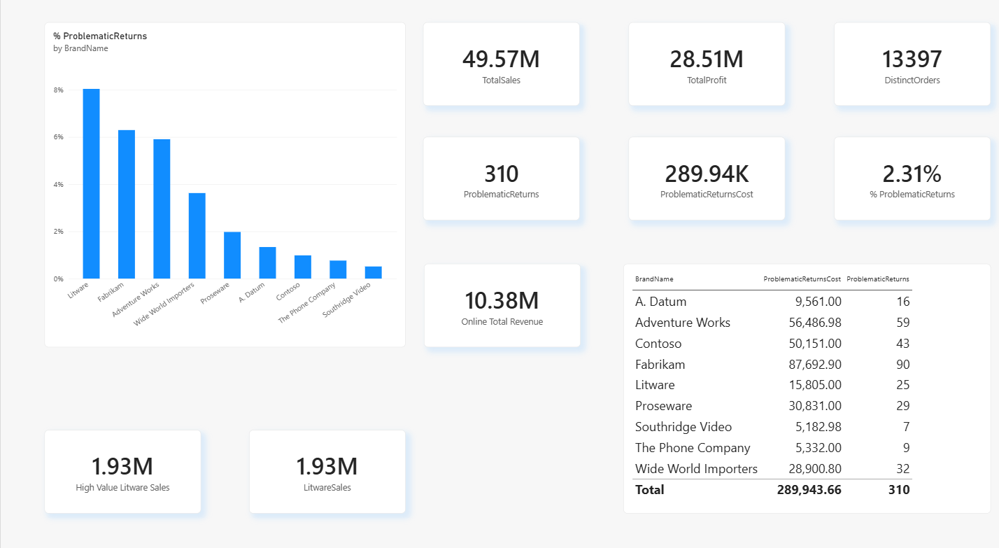

# Week 3: DAX, Measures and a KPI Dashboard

Case study from Data Science Academy. The task: use a sales dataset to create calculated columns and measures with DAX, then show the results in a dashboard.

## Files in this folder

| File | What it is |
| ---- | ---------- |
| `Power_BI_Case_Study_3.pdf` | The 10 questions of the case study |
| `Case_study_3.xlsx` | The dataset (3 sheets: Sales, Product, Channel) |
| `PBI-W3-HomeWork.pbix` | My Power BI file with the model and the dashboard |
| `Dashboard_Week3.png` | Screenshot of the finished dashboard |

## Dashboard



## The data

- **Sales**: 13,397 rows (one row per sale), from 1 Jan 2011 to 31 Dec 2013. Main columns: `SalesAmount`, `TotalCost`, `ReturnAmount`, `ProductKey`, `channelKey`, `PromotionKey`.
- **Product**: 1,690 products with `BrandName`, `ClassName`, and prices.
- **Channel**: 4 sales channels (Store, Online, Catalog, Reseller).

## Relationships (Question 2)

Power BI detected both relationships automatically. Both are many-to-one:

- `Sales[ProductKey]` -> `Product[ProductKey]`
- `Sales[channelKey]` -> `Channel[Channel]`

## Answers

### 3. Profit column

```
Profit = Sales[SalesAmount] - Sales[TotalCost]
```

### 4. Percentage of profitability column

```
%, Profitability = Sales[Profit] / Sales[TotalCost]
```

This shows how much profit I make for every 1 unit of cost.

### 5. Total Profit (column or measure?)

```
TotalProfit = SUM(Sales[Profit])
```

**Result: 28.51M** (total sales 49.57M, total cost 21.06M).

A **measure** is more useful than a column here. A column is calculated once for every row and takes up memory, and it cannot change when the user clicks a filter. A measure is calculated on the fly, so it always matches the filters and slicers on the page (for example, one brand or one year).

### 6. Count of different orders

```
DistinctOrders = DISTINCTCOUNT(Sales[SalesKey])
```

**Result: 13,397.** The dataset has no order number column, so I treat each `SalesKey` as one order line.

### 7. Problematic Cases (ReturnAmount > 500)

```
ProblematicReturns =
CALCULATE(
    COUNTROWS(Sales),
    KEEPFILTERS(Sales[ReturnAmount] > 500)
)
```

**Result: 310 cases.** I also made a second measure for how much money these cases cost:

```
ProblematicReturnsCost =
CALCULATE(SUM(Sales[ReturnAmount]), Sales[ReturnAmount] > 500)
```

**Result: 289.94K.**

### 8. Percentage of problematic cases, by brand

```
% ProblematicReturns =
DIVIDE([ProblematicReturns], COUNTROWS(Sales), 0)
```

**Result: 2.31% of all sales rows.**

I visualized it as a **column chart sorted from high to low**, with `BrandName` on the axis. It is the easiest visual for this because there are only 9 brands, the bars are easy to compare, and the worst brands show up on the left.

| Brand | % problematic |
| ----- | ------------- |
| Litware | 8.04% |
| Fabrikam | 6.29% |
| Adventure Works | 5.91% |
| Wide World Importers | 3.62% |
| Proseware | 1.98% |
| A. Datum | 1.34% |
| Contoso | 0.98% |
| The Phone Company | 0.76% |
| Southridge Video | 0.51% |

**Insight:** Litware has the highest share of problematic returns. Fabrikam has the highest total return cost (87.7K) because it has more cases.

### 9. Total revenue of the "Online" channel

```
Online Total Revenue =
CALCULATE(SUM(Sales[SalesAmount]), Sales[channelKey] = 2)
```

**Result: 10.38M** from 2,112 online sales. Channel 2 is "Online" in the Channel table.

### 10. Litware sales above 10,000 (with CALCULATE)

```
LitwareSales =
CALCULATE(SUM(Sales[SalesAmount]), 'Product'[BrandName] = "Litware")
```

```
High Value Litware Sales =
CALCULATE(
    [TotalSales],
    'Product'[BrandName] = "Litware",
    FILTER(
        VALUES('Product'[ProductName]),
        [TotalSales] > 10000
    )
)
```

**Results:** Litware sales are 1.93M in total. After keeping only the Litware products with more than 10,000 in sales, the result is 1.93M (1,930,557). 44 of the 45 Litware products pass this filter, so the number barely changes.

## What I learned

- A **calculated column** is calculated per row and stored. A **measure** is calculated when it is used, and it reacts to filters.
- `CALCULATE` changes the filter context. It is the most important DAX function so far.
- `DIVIDE` is safer than `/` because it handles division by zero.
- Always check the numbers against the source data. A measure can run without errors and still return the wrong thing.

## Tools

Power BI Desktop, DAX, Excel
