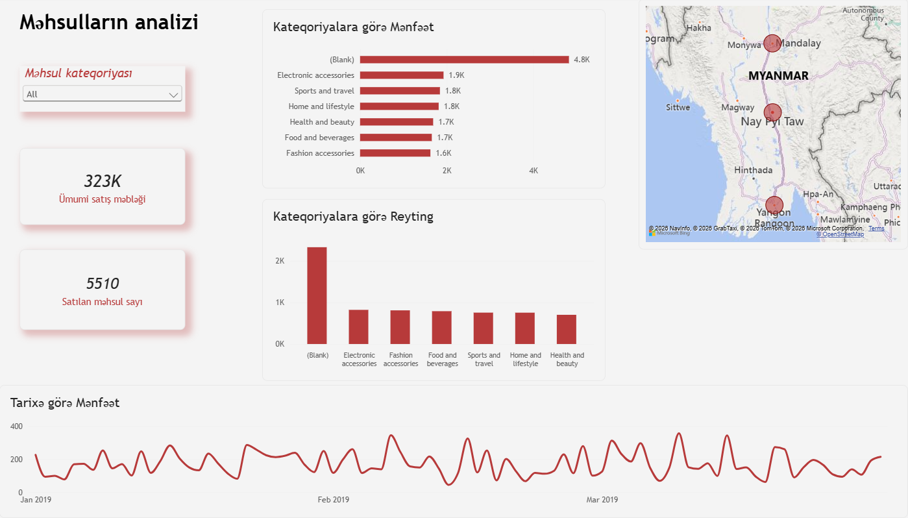
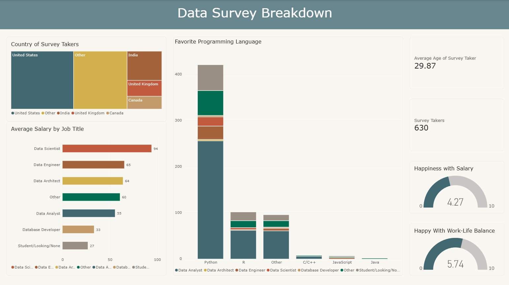

# Power BI Journey

My learning journey into Power BI, as part of my path to becoming a data scientist.

I am documenting everything I learn here: homework, practice files, and dashboards. The repo is updated at the end of every week.

**Started:** 13 October 2026

---

## About me

I graduated in marketing from Azerbaijan State University of Economics and I am moving into data science. I already work with Python Libraries(Pandas, NumPy) Excel , SQL , ML & NN models. Power BI is the next tool I am adding, so I can turn data into dashboards that people can understand and use.

## Goals

- Learn to load, clean, and model data in Power BI
- Build clear and interactive dashboards
- Learn basic DAX (formulas for calculations)
- Finish with a portfolio-ready dashboard project

## Learning plan (4 weeks)

| Week | Topic | Folder | Status |
| ---- | ----- | ------ | ------ |
| 1 | Power Query: data cleaning, append, merge, unpivot, relationships | [PBI-WEEK1_HW](PBI-WEEK1_HW) | Done |
| 2 | Data modeling, relationships, first dashboard: visuals, slicers, formatting | [PBI-WEEK2_HW](PBI-WEEK2_HW) | Done |
| 3 | DAX: calculated columns, measures, CALCULATE, KPI dashboard | [PBI-WEEK3_HW](PBI-WEEK3_HW) | Done |
| 4 | Data cleaning in Power Query + survey dashboard (treemap, gauges, stacked chart) | [PBI-WEEK4_HW](PBI-WEEK4_HW) | Done |

> I update this table every week.

## Weekly log

### Week 1: Power Query and data modeling

Folder: [PBI-WEEK1_HW](PBI-WEEK1_HW)

- Imported an Excel file and fixed column data types
- Filtered rows and created a whole-number `Customer Codes` column
- Combined two sales tables with **Append**, and joined tables with **Merge**
- Used **Unpivot Other Columns** to turn product columns into rows
- Added a conditional column (`Sales Analysis`: high / low)
- Created a **many-to-many relationship** between two tables

### Week 2: Product analysis dashboard

Folder: [PBI-WEEK2_HW](PBI-WEEK2_HW)



- Loaded the supermarket data with **Transform data** and checked column types, especially `Time`
- Created a **relationship** between the category and sales tables (`MəhsulID` and `Məhsul kodu`)
- Built a **line chart** (custom color, bold and larger X axis) and a **bar chart** for categories
- Added **cards** for total sales and products sold, and a **map** for sales by city
- Added a **slicer** for product category to filter all visuals
- Built a **clustered column chart** for ratings by category
- Grouped product categories with **New group** and added a report **title**

### Week 3: DAX, measures and a KPI dashboard

Folder: [PBI-WEEK3_HW](PBI-WEEK3_HW)


- Checked the relationships between the Sales, Product and Channel tables
- Created the `Profit` and `%, Profitability` calculated columns
- Learned why a **measure** is better than a column for totals like Total Profit
- Wrote measures for total sales, total profit, distinct orders, and "problematic" returns (return amount above 500)
- Used **CALCULATE** with filters for Online revenue and high-value Litware sales
- Built a dashboard with KPI cards, a sorted column chart of problematic returns by brand, and a table

### Week 4: Data Professional Survey dashboard

Folder: [PBI-WEEK4_HW](PBI-WEEK4_HW)



- Cleaned a raw survey (630 answers) in Power Query: removed empty columns, fixed data types, split columns to remove extra text
- Turned salary ranges like `41k-65k` into a number by taking the middle of the range (`AverageSalary`)
- Built a **treemap** (country), a **bar chart** (average salary by job title) and a **stacked column chart** (favorite programming language by job title)
- Added **cards** for average age and number of survey takers, and two **gauges** for happiness with salary and work-life balance

## Repository structure

```
Power-BI-Journey/
├── README.md
├── PBI-WEEK1_HW/
│   ├── README.md
│   ├── questions.txt
│   └── PBI-W1-HomeWork.pbix
├── PBI-WEEK2_HW/
│   ├── README.md
│   ├── questions.txt
│   ├── dashboard.png
│   ├── PBI-W2_HomeWork.pbix
│   └── SuperMarket_Data.xlsx
├── PBI-WEEK3_HW/
│   ├── README.md
│   ├── Power_BI_Case_Study_3.pdf
│   ├── Case_study_3.xlsx
│   ├── PBI-W3-HomeWork.pbix
│   └── Dashboard_Week3.png
└── PBI-WEEK4_HW/
    ├── README.md
    ├── PowerBI-Week4.xlsx
    ├── PBI-Week4.pbix
    └── Week4_Dashboard.png
```

More folders will be added each week.

## Tools

- Power BI Desktop
- Power Query
- DAX
- Excel / CSV datasets

## Contact

- LinkedIn: [*uzeyirelivasli*](https://www.linkedin.com/in/uzeyirelivasli/)
- GitHub: [uzeyirelivasli](https://github.com/uzeyirelivasli)
